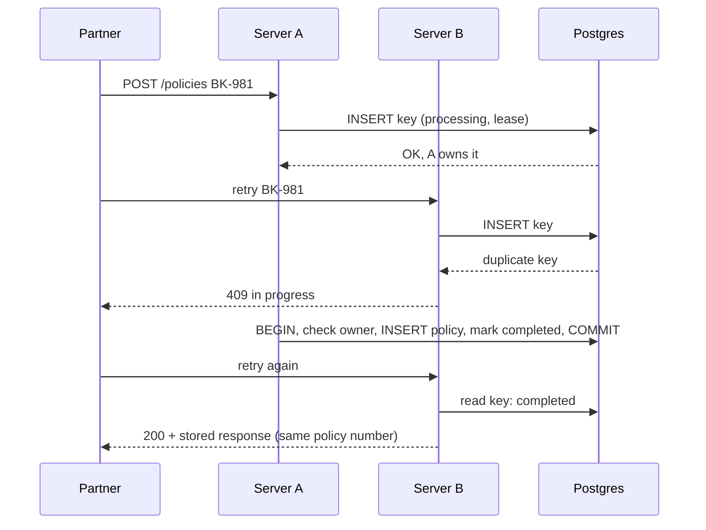

# Idempotent policy API

A partner (a booking app) calls this API to issue embedded insurance at checkout. Networks drop responses, so partners retry. This API guarantees **at most one policy per booking**, however many retries arrive, how many servers handle them at once, and whether a server crashes or stalls mid-request.

**Live demo:** https://idempotent-policy-api.vercel.app: pick a failure (20 simultaneous requests, crash mid-request, stalled server), run it against the real API, and watch a split screen replay the events the server recorded.

All partners, bookings and users are **synthetic**. Status: **implemented, tested, deployed as a demo.** Not a production service (see [What it doesn't cover](#what-it-doesnt-cover)).

## The problem

```
Partner ──POST /policies BK-981──▶ API ──▶ creates policy, records ₹49
Partner ◀── 201 Created ───────── ✕ lost in the network
Partner ──retry BK-981──────────▶ API ──▶ creates a second policy
```

Nothing errors. The duplicate surfaces weeks later, when finance reconciles bookings against policies.

## How it's prevented

Four independent mechanisms, each tested:

| # | Mechanism | Stops |
|---|---|---|
| 1 | **Claim by insert under a unique key** (`partner_id + booking_id`): the database lets exactly one insert win | Two servers both creating a policy for overlapping requests |
| 2 | **Lease + conditional takeover**: after a crash, `UPDATE … WHERE locked_until < now()` lets exactly one server take over (rows affected = 1) | A crashed request blocking the booking forever, or two servers taking over at once |
| 3 | **One transaction + fencing token**: the policy and the "completed" status commit together, only while `owner_token` still matches | A stalled server waking up after a takeover and writing a second policy |
| 4 | **Unique booking on `policies`** | Any bug elsewhere storing two policies for one booking |



### Response by state

| Server finds | Response |
|---|---|
| Its own claim insert won | `201` new policy |
| Key `completed`, same request body | `200` stored response, byte-identical, header `idempotent-replayed: true` |
| Key `processing`, lease running | `409` retry later |
| Key `processing`, lease expired | conditional takeover: winner proceeds, loser gets `409` |
| Key exists with a different body (`request_hash` mismatch) | `422 idempotency_key_reused` |
| Invalid body | `400`, nothing written |

## Design decisions

**Database constraint, not a separate lock service.** A lock held in another system (Redis, an in-process mutex) can disagree with the database. A unique constraint in the same database as the policy can't. *Cost:* one extra write per request, and key rows to retain.

**Same key with a different body is rejected, not applied.** The server can't tell a genuine upgrade from a partner bug or a reused booking ID, and changing an issued policy is an endorsement with its own audit trail. An idempotency key means "same request, same result", never "latest request wins".

**Replays return the stored bytes.** Rebuilding the response could change it; storing it guarantees the partner sees the same policy number every time.

**Events are logged outside the transaction.** Every decision (claim won, duplicate key, takeover, fenced rollback) goes to an `events` table on a separate connection, so a rollback can't erase the record of what happened. The demo replays these events; nothing on the process map is scripted.

**Lease length is a product decision.** Too short and healthy-but-slow servers get taken over; too long and a crashed request blocks checkout. The demo uses 3 s so scenarios run quickly; production would sit comfortably above p99 latency.

## Verification

- **21 automated tests against a real Postgres server** ([embedded-postgres](https://github.com/leinelissen/embedded-postgres)), not a mock, because the guarantees are database behaviour.

  | Check | Scenario |
  |---|---|
  | AC1–AC2 | Single request; retry gets a byte-identical replay |
  | AC3 | 20 simultaneous requests × 25 bookings (500 requests): zero duplicates, no 5xx |
  | AC4–AC5 | Same key + different body → 422; key scoped to partner |
  | AC6 | Crash after claim: 409 while the lease runs, then takeover → 201 |
  | AC7 | Two takeovers at the same moment, ×10: exactly one winner |
  | AC8 | Stalled original fenced off and rolled back |
  | AC9 | Invalid input → 400, nothing written |
  | AC10–AC11 | Visualiser state derived only from recorded events; 20 requests → one winner |

- **Mutation check.** Removing `locked_until < now()` from the takeover makes AC7 fail with two takeover winners. (No duplicate policy appears even then, because mechanism 4 still holds; the test checks the mechanism, not only the outcome.)
- **Live.** `scripts/race.mjs` fires 20 simultaneous first requests at the deployed API: across three runs, 7, 9 and 5 requests were told to wait (genuine overlap), with exactly one policy in the database each time.

## Run it

Requires Node 20+. Tests need no database setup: they start a local Postgres themselves.

```bash
npm install
npm test
```

On Windows PowerShell, use `npm.cmd` if script execution is disabled.

To run against your own Postgres (e.g. Neon): copy `.env.example` to `.env`, set `DATABASE_URL`, then:

```bash
npm run db:migrate
node scripts/smoke.mjs https://<your-deployment>
node --env-file=.env scripts/race.mjs https://<your-deployment> 20
```

| Path | What |
|---|---|
| `src/issuePolicy.ts` | Claim, retry decision, takeover, fenced transaction |
| `db/schema.sql` | `idempotency_keys`, `policies`, `events` |
| `api/policies.ts` | `POST /api/policies` (demo fault injection: `?simulate=crash`, `?stall_ms=`) |
| `api/runs.ts`, `src/runs.ts` | `GET /api/runs?id=`: events and rows for one demo run |
| `public/` | Split-screen visualiser; `replay.js` is the pure, tested replay logic |
| `test/` | AC1–AC11 |

## What it doesn't cover

No authentication or rate limiting (anyone can write synthetic rows to the demo), no expiry of old keys, single region, and no real external side effects. A real payment or email call would need its own idempotency key passed downstream, or would have to run only after commit. On Vercel, the simulated crash reaches the client as a `500` (the platform's response to a dropped connection), which the demo labels.

## How it was built

Built with AI-assisted development (Claude Code). I wrote the acceptance checks before any code and verified each one against the test output and the live system.
